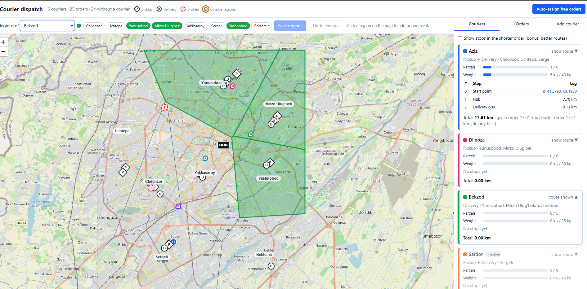
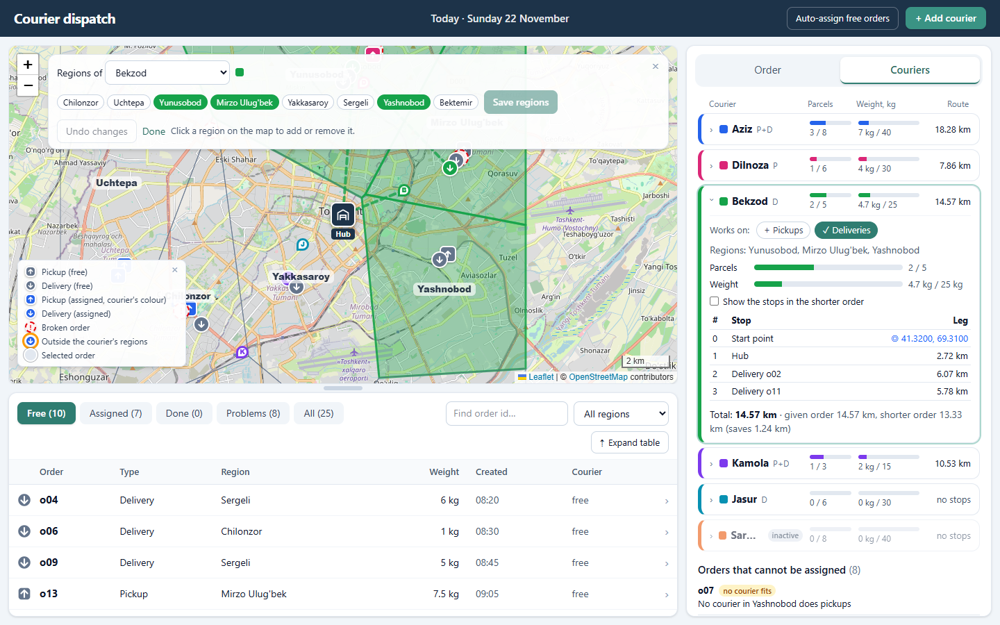
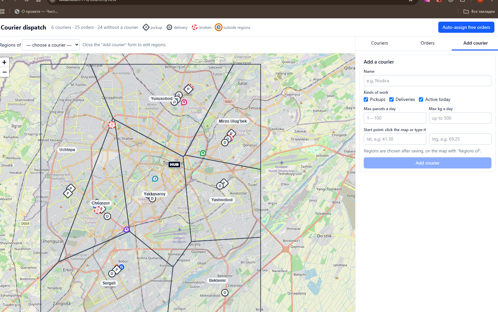
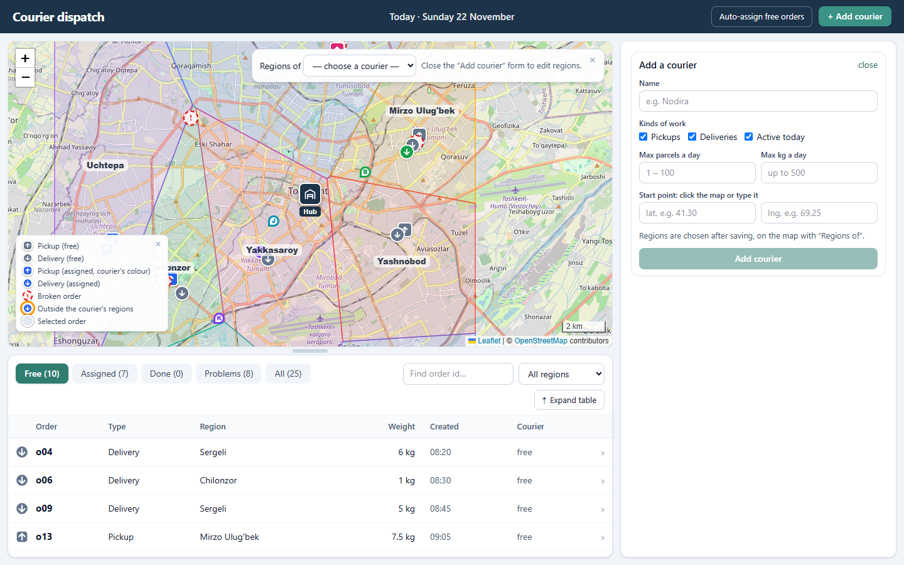
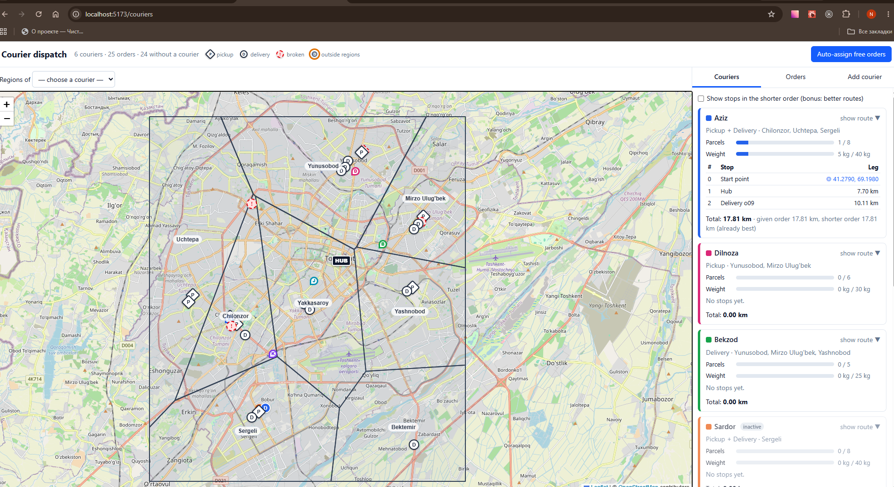
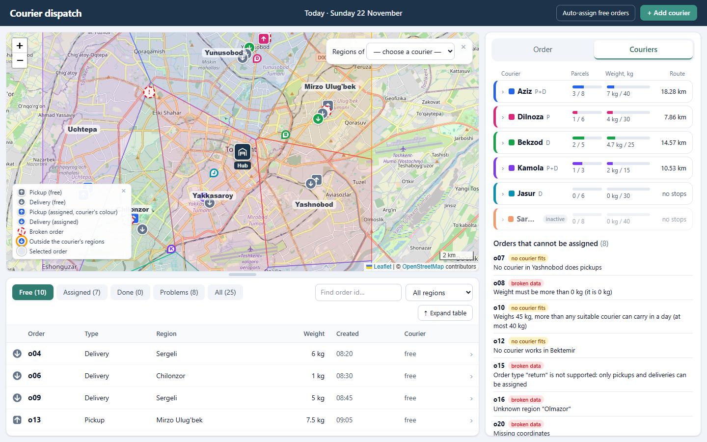
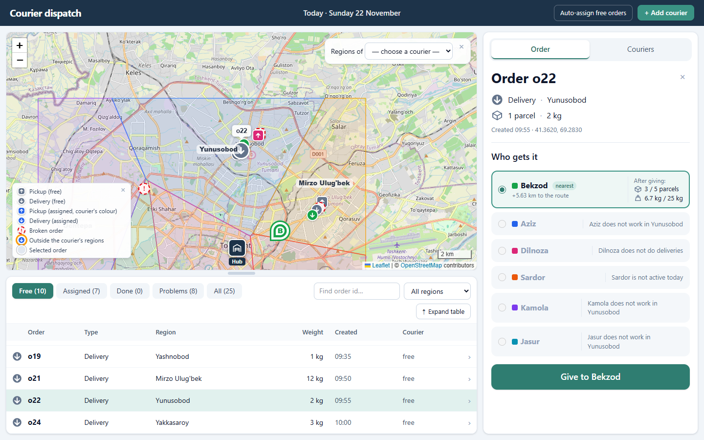
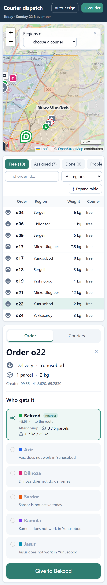

# Courier auto-assign

A dispatcher's tool for one hub in Tashkent. The page shows a map of regions, orders and couriers. On it the dispatcher chooses each courier's regions, adds couriers and hands out orders. A Go server stores the data and checks every rule.

- **Backend:** Go 1.24+, standard library only (`net/http`, `encoding/json`). Data lives in memory and is reloaded from `data/` on every start.
- **Frontend:** React 19 + TypeScript (Vite), React Router 7, TanStack Query 5 (server data), React Hook Form + zod (add-courier form), Tailwind CSS v4, Leaflet with OpenStreetMap tiles.
- The task text is in [docs/TASK.md](docs/TASK.md); the follow-up task (dispatcher page improvements, courier phone page) is in [docs/TASK2.md](docs/TASK2.md). What changed for it: [Dispatcher page improvements](#dispatcher-page-improvements).

## How to run

First copy the settings template once (the server and the page both read `.env` from the repository root):

```sh
cp .env.example .env
```

With Docker (one command, then open http://localhost:8080):

```sh
docker compose up --build
```

Without Docker, using two terminals (needs Go ≥ 1.24 and Node ≥ 20):

```sh
cd backend && go run ./cmd/server       # API on SERVER_ADDR (:8080), loads DATA_FILE and REGIONS_FILE
cd frontend && npm install && npm run dev # page on http://localhost:5173, /api goes to API_PROXY_TARGET
```

Courier app (React Native with Expo; the courier picks their name, sees today's stops in route order and marks them done): see [mobile-app/README.md](mobile-app/README.md) and [Courier phone app](#courier-phone-app) below.

```sh
cd mobile-app && npm install && npx expo start   # scan the QR code with Expo Go
```

## Settings (.env)

All settings live in `.env` in the repository root; [.env.example](.env.example) is the committed template with every variable explained. `.env` itself is in `.gitignore`.

| Variable | Used by | Meaning |
| --- | --- | --- |
| `SERVER_ADDR` | Go server | listen address, e.g. `:8080` |
| `DATA_FILE`, `REGIONS_FILE` | Go server | seed files, relative to `backend/` |
| `STATIC_DIR` | Go server | optional folder with the built page to serve |
| `API_PROXY_TARGET` | Vite dev server | where `/api` is forwarded during `npm run dev` (not sent to the browser) |
| `VITE_TILE_URL`, `VITE_TILE_ATTRIBUTION`, `VITE_MAP_ZOOM` | page | map tiles and starting zoom |
| `APP_PORT` | docker compose | port on your machine |

Order of precedence for the server: command-line flag (`-addr`, `-data`, `-geo`, `-static`), then a real environment variable, then `.env`. A missing required setting stops the server or the page with a message that says which one. The Go server reads `.env` itself (no extra library); Vite reads it through `envDir`. Inside the Docker image the paths differ, so the Dockerfile sets the server variables; the page is built with your `.env` (or `.env.example` if there is none).

Tests:

```sh
cd backend && go test ./...
```

## Page addresses

Each view of the page has its own link, so it can be shared, reloaded or reached with the browser's back button. The order table's filter stays in the query string on every one of them:

| Address | What it shows |
| --- | --- |
| `/couriers` | courier panel |
| `/couriers/c1` | courier panel, with that courier's route drawn on the map |
| `/couriers/new` | the add-courier form ("+ Add courier" in the header); clicks on the map set the start point |
| `/orders` | no order open; the table under the map shows free orders, oldest first (`/` and unknown addresses redirect here) |
| `/orders?show=problem&region=Chilonzor&q=o1` | the list's filter (`free`, `taken`, `problem`, `all`), region and id search |
| `/orders/o12` | that order open in the right panel, ready to assign |

The Go server sends the page for any address that is not a file or `/api/...`, so these links also work after a reload in the Docker build.

## API

Every error response is JSON: `{"code": "...", "error": "plain sentence"}`. A form error also carries `"fields": {"max_kg": "..."}`.

| Method | Path | Body | Notes |
| --- | --- | --- | --- |
| GET | `/api/state` | | hub, regions, couriers (with load, route, better route, orders outside their regions), orders, and orders that cannot be assigned with the reason |
| GET | `/api/regions.geojson` | | region shapes |
| POST | `/api/couriers` | `{name, kinds, max_parcels, max_kg, start:{lat,lng}, active?, regions?}` | 201, or 400 with `fields` |
| PUT | `/api/couriers/{id}/regions` | `{regions: [...]}` | replaces the courier's regions |
| PUT | `/api/couriers/{id}/kinds` | `{kinds: ["pickup", "delivery"]}` | replaces the courier's kinds of work: at least one; 409 `kind_in_use` when a kind is taken away while the courier holds orders of it |
| GET | `/api/orders/{id}/candidates` | | every courier except the holder: `{courier_id, allowed, code?, reason?, added_km, nearest, load}`, allowed first, nearest on top |
| PUT | `/api/orders/{id}/courier` | `{courier_id}` | assigns the order, or moves it if another courier holds it; 409 `order_done` when its stop is done |
| DELETE | `/api/orders/{id}/courier` | | takes the order off its courier; 409 `order_done` when its stop is done |
| POST | `/api/couriers/{id}/stops/{orderId}/done` | | the courier marks the stop of their order done; the order comes back with `done_at`. 409 `not_your_order`, `already_done` or `out_of_order` (see [stop rules](#stop-rules)) |
| GET | `/api/auto-assign` | | the plan, changing nothing: `{assigned: [{order_id, courier_id, added_km}], unplaced: [{order_id, reason}]}`, assigned grouped by courier in route order |
| POST | `/api/auto-assign` | `{assignments: [{order_id, courier_id}]}` | gives out exactly that confirmed plan, in its order, all or nothing; 409 `plan_outdated` naming the item when the data changed since the plan, and nothing is assigned. With no body it plans and gives out in one step (for curl) |

Status codes: 400 for an unusable request (bad JSON, wrong types, unknown fields, failed checks), 404 for an unknown order or courier, 409 for a rule refusal.

Try it with curl:

```sh
curl -X PUT localhost:8080/api/orders/o12/courier -d '{"courier_id":"c5"}'
# 409 {"code":"wrong_region","error":"Kamola does not work in Bektemir"}
```

## Rules the server enforces

All rules live in [backend/internal/domain/rules.go](backend/internal/domain/rules.go) (`CanTake`). They are checked in this order, and the first rule that fails gives the message:

1. The order is not broken: `Order o15 cannot be assigned: Order type "return" is not supported: only pickups and deliveries can be assigned`
2. The courier is active: `Sardor is not active today`
3. The courier does that kind of work: `Dilnoza does not do deliveries`
4. The courier works in the order's region: `Kamola does not work in Bektemir`
5. Parcel room is left, with pickups and deliveries counted together: `Kamola has no room: already 3 of 3 parcels today`
6. Weight room is left: `Kamola cannot carry 6 kg more: already 12 of 15 kg today`

One more rule came with the courier app: **no new pickup for a courier who has already delivered something** (`past_hub`): `Kamola has already left the hub with deliveries, so a new pickup does not fit today's route`. It is checked after the region and before the limits, so auto-assign and the courier cards follow it too.

### Stop rules

[domain/stops.go](backend/internal/domain/stops.go) (`CanMarkDone`, `CanRelease`). When a courier marks a stop done, the server checks, in this order:

1. The order is on this courier's route: `Order o23 is not on Dilnoza's route` (`not_your_order`)
2. It is not done already: `Order o23 is already done` (`already_done`)
3. Every stop before it on the route is done: `Do stop 1 (order o23) first: stops go in route order` (`out_of_order`). The route is start, pickups, hub, deliveries, so this also means no delivery before every pickup.

A done order cannot be taken off or moved any more: `Order o23 is already done, so it stays with its courier` (`order_done`). The parcel has already been picked up or handed over.

The use case layer ([usecase/dispatcher.go](backend/internal/usecase/dispatcher.go)) holds one lock around each change, so a check and the change it allows happen as one step.

## The seed data

These orders are broken. They are shown on the map with a red dashed "!" pin and in the panel with their reason, and they can never be assigned:

| Order | Problem |
| --- | --- |
| o08 | weight is 0 kg |
| o15 | type `"return"` is not pickup or delivery |
| o16 | region `"Olmazor"` is not in the region list (the point falls inside Chilonzor's shape, but I do not guess) |
| o20 | `lat` is `null`, so there is no pin; the order appears only in the lists |
| o03 (second one) | duplicate id. The first `o03` is kept. The second gets the internal id `o03-2` and is marked broken, because its data differs slightly and nobody can tell which copy is right |

These orders are valid, but no courier can take them right now. They are listed under "Orders that cannot be assigned", and the reason is worked out again on every request, so it changes when couriers or regions change:

| Order | Reason |
| --- | --- |
| o07 | No courier in Yashnobod does pickups (Bekzod does deliveries only) |
| o10 | 45 kg is more than any suitable courier can carry in a day (Aziz's limit is 40 kg) |
| o12 | No courier works in Bektemir |

Other things in the data:

- **o06** has region `" chilonzor "`. I read it as **Chilonzor**, ignoring case and extra spaces, and the order shows a note saying so. The intent is clear and the point lies inside Chilonzor, so refusing the order would only create work for the dispatcher. This is the one place where I fix up input instead of refusing it.
- **o23** was created at 08:00 but sits near the end of the file. Nothing breaks: auto-assign handles orders oldest first, so it goes first.
- **Jasur** (c6) has no regions, so can take nothing until the dispatcher adds some. **Sardor** (c4) is inactive.

## Decisions and assumptions

- **One endpoint for assigning and moving.** `PUT /orders/{id}/courier` assigns a free order, or moves an assigned order in one step. If the new courier is refused, the order stays with the old one. Assigning to the courier who already has the order is refused as `already_assigned`.
- **The route** is the courier's start point, then their pickups in the order given, then the hub, then their deliveries in the order given. A courier with only deliveries goes start → hub → deliveries. A courier with only pickups ends at the hub. A courier with no orders has no route (0 km). "Order given" means the time of assignment, so a moved order goes to the end of its new courier's list.
- **Km** are straight-line (haversine) distances. Each leg is rounded to 0.01 km, and the total is the sum of the rounded legs, so the numbers on screen add up.
- **Region change** replaces the whole list. Orders the courier already holds stay with them. Those outside the new regions get an orange ring on the map and an "outside" tag in the panel and lists. New orders in a dropped region are refused.
- **New courier checks** (the same in the page and on the server, in [courier_draft.go](backend/internal/domain/courier_draft.go) and [courierForm.ts](frontend/src/domain/courierForm.ts)):
  - Name is required, at most 50 characters, and must not match an existing name ignoring case. Refusal messages use names, so two Kamolas would make "Kamola does not work in Bektemir" ambiguous.
  - At least one kind of work.
  - `max_parcels` is a whole number from 1 to 100.
  - `max_kg` is more than 0 and at most 500.
  - The start point is within lat 41.0–41.6 and lng 69.0–69.6 (around Tashkent).
  - Regions are optional when adding. The page asks for them on the map right after saving.
  - Unknown JSON fields and wrong types (for example `"max_parcels": 2.5` or `"max_kg": "10"`) are refused with a field message.
- **Weights** use a 1e-9 tolerance, so 12.1 + 2.9 kg fits a 15 kg limit despite float rounding.
- **Courier colours** come from a fixed palette by the courier's position in the list.
- **Kinds of work can be changed** after a courier is added (pickups only → both, both → one). Adding a kind is always allowed. Taking one away is refused while the courier still holds orders of that kind ("Aziz still has 1 delivery: o06. Take it off or move it first"). Unlike a region change, a courier who no longer does deliveries could not deliver a parcel they hold, so the dispatcher moves those orders first. A courier keeps at least one kind.
- Couriers cannot be edited otherwise (except regions and kinds), deactivated or deleted, and orders cannot be created. The task does not ask for this.

## Bonus parts

- **Auto-assign** (button at the top right). It plans all free, valid orders together and gives each one to a courier allowed to take it. Orders already assigned are not touched. Orders it cannot place are listed with the reason: either the permanent reason (region, kind, inactive, weight) or "Every courier allowed to take it is full: …" with each courier's limit.
  - **Nothing is given out before the dispatcher confirms.** The button opens "Auto-assign: check before giving out": the plan grouped by courier, each order with its region, weight and the km it adds, each courier's parcels and kg after the plan against their limits, and the orders not placed with the reason (folded away). "Confirm: give out 14 orders" gives it out and closes the dialog with a short message ("14 orders given out"); there is no report afterwards, since the dialog already showed it. Cancel, Escape or a click outside closes it and nothing changes. Auto-assign touches many orders at once, so a look before it happens is cheaper than undoing it order by order.
  - **What is confirmed is what is given out.** The page sends back the exact plan it showed, and the server gives out those items in that order or none of them. If something changed in between (another dispatcher gave one of the orders out, a courier filled up, a region was taken away), the server refuses with `plan_outdated` and says which order and why, for example "The plan is out of date: o01 already has a courier (Aziz). Nothing was assigned; check the plan again". The dialog shows that with "Check again", which asks for a fresh plan. I chose this over planning again on confirm, because then the dispatcher could get a different plan from the one they read.
  - **How "nearest" is measured:** by how much a courier's route grows, in km, when the order is added to it. I picked this over "closest start point" because it accounts for where the courier already has to go, including the trip to the hub. For a courier with no orders it is roughly start → order → hub. The order panel's "nearest" card uses the same measure for one order.
  - **What the plan aims for**, in this order: (1) place as many orders as possible, (2) keep the total km of all routes as low as possible. An order left out is a parcel that does not move today, so it weighs more than any number of km. The plan lives in [domain/plan.go](backend/internal/domain/plan.go) (`PlanAssignments`), with no I/O, and every step checks `CanTake`.
  - **How it gets there:**
    1. *Regret insertion.* For every order still free, it compares the km it would add with its best courier and with its second best. The order that would lose the most by not getting its best courier goes first. An order only one courier can take loses everything, so it goes before orders that have a choice.
    2. *Make room.* An order that nobody could take gets a place when one of the plan's orders can move from a courier who could take it to another courier who has room.
    3. *Improve.* Plan orders are moved, or swapped in pairs, between couriers while that cuts the total km.
    4. The same steps also run from the old one-by-one start (oldest order first, each to its nearest courier), and the better of the two plans wins. Steps 2 and 3 never drop an order, so auto-assign never places fewer orders than the one-by-one way did.
  - **Route order.** The route still follows the order in which orders were given, but auto-assign gives a courier's new orders in the order of their shortest route (after the orders they already hold; pickups before the hub, deliveries after it). So right after auto-assign, "the order given" and "the shorter order" are the same. `added_km` in the answer is how much each order adds after the ones given before it, so a courier's numbers add up to their route.
  - **What it gains.** On the seed data the one-by-one way placed 13 orders in 95.30 km. o23, the oldest, took Kamola's last room, so o14, o18 and o24 were left out. The plan places 14 orders in 68.95 km. On 500 random days (5 couriers, 25 orders) it placed more orders on 362 of them, and on the others it was shorter every time, 25.6 % fewer km in total. It takes about 50 ms on the seed data.
  - **Limits.** It is a heuristic, not a proven best plan. Make room moves only one order at a time, so a gap that needs a chain of two moves stays unplaced. Each courier's stops are put in order exactly up to 7 pickups and 7 deliveries, and above that with nearest neighbour followed by 2-opt.
- **Reassign:** in the open order, choose another courier under "Move to" and press "Move to …", or press "Take off". Undo puts it back.
- **Better routes:** each courier card shows the km in the given order and in a shorter order. A checkbox switches the stop list and the map line to the shorter order. Pickups stay before the hub and deliveries after it. Each part is solved exactly by trying every order when it has 7 stops or fewer, and otherwise by nearest neighbour followed by 2-opt. The shorter order is only shown, never saved: the rule says the route follows the order given.
- **Docker:** `docker compose up --build` builds the page and the server into one image.

## Dispatcher page improvements

The follow-up task ([docs/TASK2.md](docs/TASK2.md)) asked me to improve the page for a dispatcher who uses it all working day, in three ways: **layout**, **readability**, and **the number of steps needed to assign an order**, and to choose the changes myself. Below is every change, which of the three it serves, and why I made it. The look (dark header, map over the order table, order panel with courier cards and one big button) follows mockups I was given. The texts stay in English like the rest of the project, including the server's messages.

### Before and after

The screenshots are in [screenshots/](screenshots/). The "before" ones show the page before these changes. The "after" ones show the finished page with seven orders given out (o23, o01, o05 → Aziz; o02, o11 → Bekzod; o03 → Dilnoza; o14 → Kamola), so the loads and routes differ from the "before" pictures.

| | Before | After |
| --- | --- | --- |
| Choosing Bekzod's regions |  |  |
| Adding a courier |  |  |
| Courier panel |  |  |

After only:

| An order open, ready to assign | On a phone (360 px wide) |
| --- | --- |
|  |  |

### Steps to assign an order

| Way of working | Before | After |
| --- | --- | --- |
| Going through the free orders | Orders tab → scroll to the order → click it → open the courier select → pick a courier → Assign: **5 actions per order** | click the order in Free (the nearest courier is already chosen) → "Give to Bekzod": **2 actions per order**, plus one click back to Free, since the table then shows Assigned |
| From a pin on the map | pin → open the select → pick a courier → Assign: **4** | pin → "Give to …": **2** (3 when choosing someone other than the nearest) |
| Undoing a wrong click | find the order → open the select → pick the old courier → Move: **4** | Undo in the message: **1** |

### All changes at a glance

| # | Change | Serves | Why, in one line |
| --- | --- | --- | --- |
| 1 | Courier cards, nearest chosen, one big button, the others disabled | steps | most orders become one click, and the reason for every refusal is visible before clicking |
| 2 | After giving an order out, the table shows Assigned with that order open | reading | the dispatcher sees at once where the order went |
| 3 | Undo | steps | one-click assigning must have a one-click way back |
| 4 | Map over the order table, Order / Couriers on the right | layout | orders, map and the open order are on screen together |
| 5 | Adjustable split, Expand table / Show map | layout | the dispatcher decides how much room the map gets |
| 6 | Dark header with date and actions | layout | global actions in one place, the legend next to the map |
| 7 | Region colours, arrow pins, hub badge, scale | reading | the map can be read without the legend |
| 8 | One line per courier | layout | the whole team's load fits on one screen |
| 9 | Order table: Free, oldest first, counts, search, region | steps, reading | the work still to do comes first, in the order it should be done |
| 10 | Map highlights who can take the order | steps | "who is closest" is visible at a glance |
| 11 | Data refreshes every 5 s | reading | changes by others show up without a reload |
| 12 | Phone layout | layout | the page stays usable on a small screen |
| 13 | Region bar: Done and × | layout | the bar does not cover the map when it is not needed |
| 14 | 14px text, darker grey, big order details | reading | less strain over a working day |
| 15 | One colour per status | reading | red means broken data and nothing else |
| 16 | Plain message when the courier list cannot load | reading | a problem is said in words instead of an endless "Checking…" |
| 17 | Change a courier's kinds of work in their card | steps | a pickup-only courier can be given deliveries (and back) in one click, without adding them again |

### Fewer steps

1. **The courier select became a card per courier, with the nearest one already chosen.** It is the biggest change. Under "Who gets it" every courier has a card. A card for an allowed courier shows the load they would have after the order (parcels and kg) and the km the order adds to their route. The nearest one by the auto-assign rule (least km added) is on top, marked "nearest" and chosen at first. A big button under the cards says what will happen: "Give to Bekzod". For most orders the dispatcher only presses it. Couriers who cannot take the order are disabled: greyed out and not selectable, with the server's reason on the card (for example "Kamola does not work in Bektemir"), so the dispatcher sees why before trying. When nobody can take the order, the button is disabled and says "Nobody can take it". The server still checks every assignment: a request sent by hand for a refused courier gets the same refusal (see the HTTP tests).
   - The cards come from a new endpoint, `GET /api/orders/{id}/candidates`. The server works it out with the same `CanTake` and the same km function as auto-assign. Before, the page repeated the rules in TypeScript (`quickCheck`) to show its hints. That copy is gone, so a hint can no longer disagree with the server. The card measures "nearest" with the same km function as auto-assign (`domain.Candidates`). Auto-assign itself plans all free orders together, so it may give an order to someone else when that lets another order be placed or cuts the total km (see [Bonus parts](#bonus-parts)).
2. **After an order is given out, the table switches to Assigned.** When an order gets its first courier, the table moves from Free to Assigned, with that order still open and highlighted, so the dispatcher sees at once that it went where they meant, and to whom. The region filter and the id search stay as they were. Taking an order off its courier does the opposite: the table switches to Free, with that order open and highlighted there. Moving an order to another courier does not switch the list. An earlier version opened the next free order instead; I dropped it, because jumping away right after giving an order out hid the result of the click.
3. **Undo.** The message after assign, move or take off has an Undo button for 8 seconds. With one-click assigning, a wrong click is more likely, and undo has to be just as cheap. Undo is an ordinary request, so the server checks it again. If the old courier filled up in the meantime, the message says so.
   - Decision: an order that Undo moves back goes to the **end** of the old courier's route, because the route follows the time of assignment. Keeping the old place would mean a second, hidden rule for route order.

### Layout

4. **Map on top, order table under it, the open order on the right.** Before, the orders, the couriers and the add-courier form shared one side panel, so looking at the list hid the couriers and the other way round. Now the order table is always on screen under the map, and the right panel has two tabs: **Order** (the open order and who gets it) and **Couriers**. Adding a courier is the "+ Add courier" button in the header, and the form opens in the right panel. `/` now opens the orders, the dispatcher's main work.
5. **The split between map and table is adjustable.** Some hours are spent on the map (regions, routes), others in the list, so one fixed split cannot suit both. The bar between them can be dragged; it follows the pointer exactly, because while dragging only the map's height is written, once per frame, and the page is not re-rendered. When the bar has focus, ↑/↓ move it, and a double-click puts it back to 60 % map. "Expand table" gives the table the whole height and hides the map; "Show map" brings it back. Both slide in 0.3 s. The split and the expanded state are remembered in the browser. Leaflet is told the new size on every change, so the tiles always fill the map.
6. **The dark header** holds the page name, today's date (Tashkent time), auto-assign and "+ Add courier": everything that is not about one order or one courier. The pin legend moved from the header onto the map's bottom-left corner, next to what it explains. It can be folded away (remembered), and the map moves a picked order out from under it.
7. **The map reads faster.** Each region has its own soft colour, so neighbouring districts are easy to tell apart. Pins carry an arrow: a square with an up arrow is a pickup (the parcel goes to the hub), a circle with a down arrow is a delivery. Free orders are grey, assigned ones take the courier's colour (the original task asks for that), broken ones are red and dashed. The selected order is larger, with its id above it. The hub is a warehouse badge. A scale bar shows distances.
8. **The courier panel is one line per courier:** name, kinds, a parcel bar, a weight bar and total km. All six couriers fit on one screen, so "who still has room" can be seen at a glance. Clicking a line slides the full card open (regions, load, stops, km) and draws the route on the map. Inactive couriers go to the bottom. The "shorter order" switch moved into the open card, where it applies.
9. **The order table opens on Free, oldest first.** Free orders are the work still to do, and oldest first is the order auto-assign uses. The pills show counts (Free (10), Assigned (7), Problems (8), All (25)), and there are an id search and a region filter. The creation time is shown (in Tashkent time). The data has no street addresses, so the table has no address column. Filter, region and search are kept in the address, so a reload or a shared link keeps them, like every other view of the page. When the table scrolls, the selected row slides to the middle of the visible rows (below the sticky header), so it is never half hidden at an edge; only the table moves, never the page.
10. **The map helps choose.** While an order is open, the start pins of the couriers allowed to take it grow and the other couriers fade. When an order is picked in the table, the map flies to it and rings pulse around its pin for a few seconds (in its courier's colour, teal while free), the same way a courier's start point does, so the eye finds it at once. When an order opens another way (a link, or after giving it out) and its pin is off screen or under the legend, the map pans to it (the zoom stays).
11. **The data refreshes by itself** every 5 seconds and when the tab gets focus. Before, the page only reloaded after the dispatcher's own changes, so changes by a second dispatcher, or stops a courier marks done in the app, stayed invisible.
12. **Phone layout.** A dispatcher works at a desk, but may need to check something away from it, and the old page broke on a phone (header in three rows, table cut off, courier names over the bars). Below 1000 px the blocks stack (map, table, order panel), the page scrolls as a whole and the map has a fixed height. Below 640 px the header has two rows, the table drops the Type, Created and arrow columns (the icon shows the type), the filter pills scroll sideways, the courier rows drop the weight bar, and picking an order scrolls to the order panel. Checked at 360 and 320 px: nothing is wider than the screen.
13. **The region bar has a Done button and a ×.** Done stops editing; before, the only way out was to choose "— choose a courier —" in the select. The × folds the whole bar into a small "Regions" button so it does not cover the map (remembered). It asks first if region changes are unsaved, and the bar opens again by itself right after a courier is added, when their regions are to be chosen.

### Reading

14. **Text is 14px instead of the browser's 16px mixed with 13px**, and grey text is darker (slate-600 instead of slate-500). The order title, the order's kind, parcel and weight, and the courier names on the cards are large. Numbers use tabular figures, so km and kg line up in columns. The side panel and the table scroll without drawing scroll bars.
15. **One colour per status, everywhere:** red only for broken data, amber for "no courier fits" and "outside regions" (before, "no courier fits" was red like broken data), the courier's colour for assigned orders, grey for free. Teal is used only for actions and for what is chosen.
16. **A plain message when the courier list cannot be loaded.** If the candidates request fails (for example a server started before this change, which answers "No such API endpoint"), the order panel says so with the server's words and a "Try again" link, instead of showing "Checking couriers…" forever.

17. **A courier's kinds of work can be changed in their card.** In the Couriers tab, the open card shows "Works on: [Pickups] [Deliveries]". A click adds or takes away that kind and saves at once, so a pickup-only courier can be given deliveries without being added again. The last kind left cannot be taken away (its button is disabled). The server refuses to take a kind away while the courier still holds orders of that kind and names them ("Dilnoza still has 1 delivery: o02. Take it off or move it first"); the message appears under the buttons. New endpoint `PUT /api/couriers/{id}/kinds`, with tests in the domain, the use case and over HTTP.

### What I did not change, and why

- **Drag-and-drop of an order onto a courier:** slower than a click or a key, awkward on a touchpad, and much more code.
- **Region editing** stays as it was (a select, then clicks on the map). It already worked in a few clicks, and the original task asked for exactly this select.
- **Russian texts from the mockups:** the project, its server messages and its tests are in English, and mixing languages would be worse than either.
- **A dark theme:** it does not help any of the three goals.
- **Frontend tests**, for the same reason as before: the rules live on the server. The new endpoint has Go tests. I drove the new flow in a headless browser: opening o23 (the oldest) shows Aziz chosen, "Give to Aziz" gives it to him and opens o01, Undo takes it back, and on o12 every courier is disabled with their reason, Kamola's being "Kamola does not work in Bektemir". I also measured the split (the table expands and the map comes back in 0.3 s; while dragging the bar is 0 px from the pointer) and the phone layout at 360 and 320 px.

## Courier phone app

The second part of the follow-up task: a page for couriers that works on a phone. On request it is a phone app in [mobile-app/](mobile-app/) (React Native with Expo, TypeScript), not a page of the web app. It talks to the same server, and every rule is checked there, so it does not matter which client sends the request.

**What the courier does**

1. **Selects their name** in "Please select yourself:". While the list loads the screen says "Loading...".
2. **Sees today's stops in route order:** the pickups, then a "Hub: drop off pickups, load deliveries" line, then the deliveries, numbered 1, 2, 3 as on the dispatcher's map. The header counts them: "Today's stops: 1 of 5 done".
3. **Marks each stop done:** only the next stop is highlighted and has a "Done" button. A tap asks "Stop 2 done?" first, so a slip of the thumb does not count. A done stop gets a green check and the time. When the server refuses, its sentence is shown as it is ("Not saved: Do stop 1 (order o23) first...") and the list reloads.

The list refreshes on its own every 5 seconds while the app is open (and at once when it is opened again), so an order the dispatcher gives out or takes off shows up within seconds. With nobody chosen, the app lists all orders with who holds them.

**On the dispatcher page** the order table has a **Done** pill: the stops couriers have marked done move there from Assigned, so Assigned is the work still to do. A done order also shows a green "done" tag next to the courier, and the order panel says "Aziz marked this stop done at 10:42. A done order stays with its courier." instead of offering Move to / Take off.

**Decisions**

- **Done is a time on the order** (`done_at`), not a separate list of stops. A stop is always one order (the hub is not a stop with an order), so this is the smallest thing that works, and the dispatcher page sees it in the state it already loads.
- **Strict route order.** The task says the courier sees the stops in route order; the server makes that the rule, so a request sent by hand cannot skip a stop or deliver before the pickups are done. The app shows the button only on the next stop, but the server does not rely on that.
- **The hub is shown but not marked.** It has no order, and "every earlier stop is done" already means every pickup is done before the first delivery.
- **Done orders stay where they are,** and a courier who has delivered something gets no new pickups: a new pickup would land before the hub on a route the courier has already passed.
- **Done stops still count toward the day's limits:** the limits are per day, and the parcel was carried.
- **"Today" is every order the courier holds:** the data is one day and has no dates to filter by.

**Skipped**

- **Undoing a done stop** from the app. A wrong tap is guarded by the confirm question; an undo would need its own rules (only the last stop, only by the same courier) and an endpoint.
- **Logins:** the courier picks their name, as the task says. Nothing stops someone from picking another name, as on the dispatcher page.
- **A map in the app:** the list in route order is what the task asks for.
- **App tests:** the rules are on the server and tested there. The app was checked for types and an Android bundle; the requests it sends were also sent by hand to a running server.

## What I skipped and why

- **A database:** the task allows memory, and losing changes on restart is fine.
- **Logins and roles:** not asked for.
- **Frontend tests:** the rules that matter run on the server, and the server has the tests. I checked the page by driving it in a headless browser: refusing o12 for Kamola, a region click on the map, the add-courier form with bad and good input, and auto-assign.
- **Checking that an order's point lies inside its region's shape:** the shapes are described as rough, so a mismatch would not prove the data is wrong. I ran the check once by hand, and every order with a known region lies inside its own shape.
- **The Docker build was not run on my machine** (Docker is not installed here). The Dockerfile is a plain multi-stage build.

## Tests

`cd backend && go test ./...`

- [domain/rules_test.go](backend/internal/domain/rules_test.go): each refusal (broken order, inactive courier, wrong kind, wrong region, parcel limit, weight limit), shared limit for pickups and deliveries, edge cases at the limit, the "nobody can take it" reasons, how the nearest courier is chosen, and the courier list for an order (allowed first, nearest on top, holder left out, auto-assign agrees with it).
- [domain/plan_test.go](backend/internal/domain/plan_test.go): the auto-assign plan places an order that the one-by-one way leaves out, gives a courier's stops in the order of their shortest route, keeps held orders, skips broken orders and pickups after the hub, and on 30 random days keeps every rule and never places fewer orders than the one-by-one way. `TestAutoAssignPlansAllOrdersTogether` in the use case test checks the seed data: at least 14 placed, less than 95.30 km, and routes already in the short order.
- [domain/courier_draft_test.go](backend/internal/domain/courier_draft_test.go): every way a new courier is refused.
- [domain/route_test.go](backend/internal/domain/route_test.go): stop order, assignment order, leg sums, empty route, and a shorter order that is never worse.
- [usecase/dispatcher_test.go](backend/internal/usecase/dispatcher_test.go): on the real seed data, broken orders never assignable, a region change keeps orders and marks them, unknown regions refused, a refused courier is not stored, a move refused or done, and auto-assign respects every rule and keeps hand assignments.
- [seed/seed_test.go](backend/internal/seed/seed_test.go): every broken seed order is found with its reason.
- [repository/memory/memory_test.go](backend/internal/repository/memory/memory_test.go): stored data cannot be changed from outside; ids and sequence numbers.
- [transport/httpapi/api_test.go](backend/internal/transport/httpapi/api_test.go): requests sent by hand over HTTP, including bad JSON, wrong types, unknown fields and unknown ids, with status codes and messages; the courier list for an order.
- [domain/kinds_change_test.go](backend/internal/domain/kinds_change_test.go): changing a courier's kinds: known kinds only, at least one, adding always allowed, taking away refused while orders of that kind are held (also in the use case test on the seed data and over HTTP).
- [domain/stops_test.go](backend/internal/domain/stops_test.go): marking stops done: next stop allowed, skipping a stop or delivering before the pickups refused, twice refused, another courier's order refused; a done order cannot leave its courier; a done delivery means the courier has left the hub (and `rules_test.go` refuses a new pickup then).
- `TestMarkStopDoneOverHTTP` in [transport/httpapi/api_test.go](backend/internal/transport/httpapi/api_test.go): after auto-assign, stop requests sent by hand: out of order, another courier, unknown courier or order, twice, and taking off or moving a done order are all refused with their codes; in order they pass.
- `TestAutoAssignPlanThenConfirm` in the same file: the plan changes nothing; a plan gone stale (its first order given out by hand meanwhile) is refused whole with `plan_outdated` naming that order; the same plan, once it fits again, is given out exactly as confirmed; a plan with a refused courier, an unknown order, an order twice, an unknown field or no assignments is refused with a reason.
- [config/config_test.go](backend/internal/config/config_test.go): reading `.env`, and flags winning over it.

## Architecture

### Backend: clean architecture

Dependencies point inwards only. The business rules know nothing about HTTP, JSON or storage, so each layer can be read, tested and replaced on its own.

```
          transport/httpapi  ──►  usecase  ──►  domain
 cmd/server ─┤                      ▲
          repository/memory ────────┘ (implements usecase.Repository)
          seed            ─────────────────►  domain
```

```
backend/
  cmd/server/main.go        composition root: config → seed → repository → use cases → HTTP
  internal/
    domain/                 entities and rules, no I/O and no JSON
      courier.go, order.go, kind.go, city.go, geo.go, load.go
      rules.go              CanTake (every assignment rule), WhyNobodyCanTake
      route.go              route in the order given; route_optimize.go the shorter order
      nearest.go            Candidates (every courier for an order, nearest marked), AddedKm
      plan.go               PlanAssignments: auto-assign plans all free orders together
      courier_draft.go      checks for a new courier
      errors.go             Refusal (rule broken) and ValidationError (bad input)
    usecase/                what the dispatcher can do; one lock makes check + change atomic
      ports.go              Repository interface the use cases need
      assign.go, candidates.go, couriers.go, auto_assign.go, overview.go
    repository/memory/      in-memory Repository (returns copies)
    seed/                   reads data.json / regions.geojson, marks broken orders
    transport/httpapi/      router, handlers, request/response DTOs, error → status mapping
    config/                 settings from .env, environment and flags
```

### Frontend: layers and features

```
frontend/src/
  main.tsx                  entry: router + App
  app/                      App (loading), Dashboard (layout), Header, SideTabs (Order / Couriers),
                            SidePanelRoutes, routes.ts (addresses), useAppRoute (address → selection)
  api/                      client.ts (fetch + ApiError), dispatchApi.ts (endpoints), types.ts (JSON shapes)
  config/env.ts             VITE_* settings from .env
  domain/                   pure logic, no React: formatting, form checks, colours
  hooks/                    shared: useDispatchState (TanStack Query, reloads every 5 s), useStateMutation (change + reload),
                            useToast (with Undo), useStoredFlag
  features/                 one folder per part of the page, one component per file
    map/                    MapView, RegionsLayer, OrderMarker, MapClickCatcher, KeepInView, Legend (on the map), mapStyles.ts
    regions/                RegionEditor, RegionChip, useRegionEditor
    couriers/               CourierPanel, CourierCard, MiniMeter, LoadMeter, RouteStops, StopLabel, RouteTotal, UnassignableList
    orders/                 OrdersTable (under the map), OrderFilters, OrderRow, OrderStatus, OrderPanel (right),
                            AssignBox, OrderDetails, CandidatePicker, useOrderList, useCandidates, useOrderActions,
                            useOrderQuery, orderFilter.ts
    add-courier/            AddCourierForm, useCourierForm (React Hook Form + zod schema from domain/courierForm.ts)
    auto-assign/            AutoAssignDialog (the plan to confirm), useAutoAssign
  shared/ui/                Button, Card, CardHeader, Tag, Alert, Toast, Swatch, Checkbox, FormField, icons, arrowPath, styles.ts
                            (colours: teal `brand-*` and `navy-*` tokens in index.css)
data/                       data.json, regions.geojson (seed)
```

Imports use the `@/` alias for `src/`. Components only draw; state and server calls live in hooks; rules and formatting live in `domain/`. Server data is read with TanStack Query; every change is a mutation that reloads the state, so no component passes a refresh function around. A hook used by one feature lives in that feature; `hooks/` holds only shared ones.

## Time and AI use

- **Time:** _fill in_.
- **AI:** I built this with Claude Code (an AI coding assistant). It read the task, wrote the backend, tests, frontend and this README, and checked the page in a headless browser. I reviewed the decisions above and the commits.
- **AI, follow-up task:** I used Claude Code the same way. I went through each possible change with it before any code was written, then chose the set above. It wrote the candidates endpoint and its tests, the page changes and this section, and drove the new flow in a headless browser. When I gave it mockups of the look I wanted, it rebuilt the layout after them (keeping English).
- **AI, courier app:** Claude Code set up the Expo app and built it step by step from my requests (the courier select, the order list, refreshing on its own), then wrote the stop rules on the server with their tests, the app's stop list and the [Courier phone app](#courier-phone-app) section. I tried each step on an Android emulator and asked for changes.
